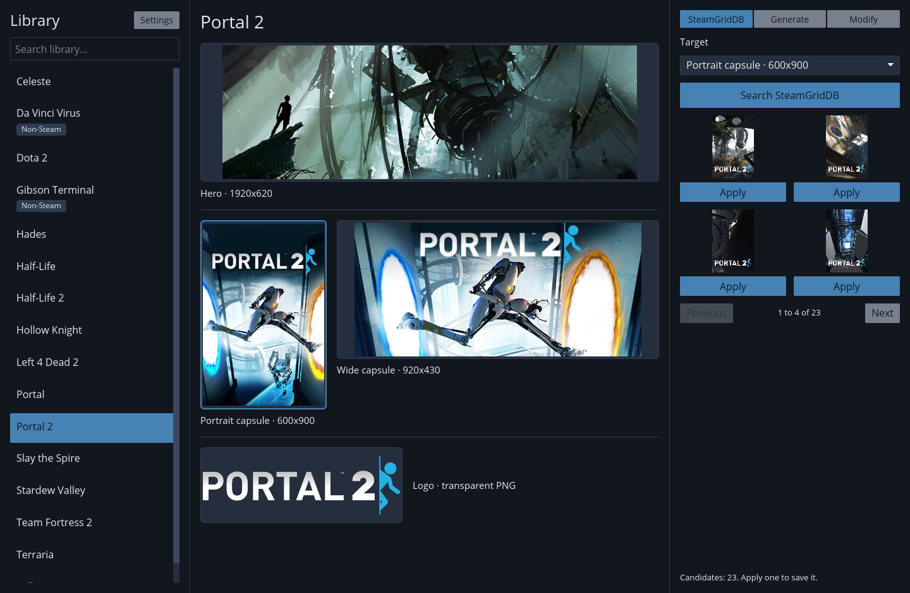
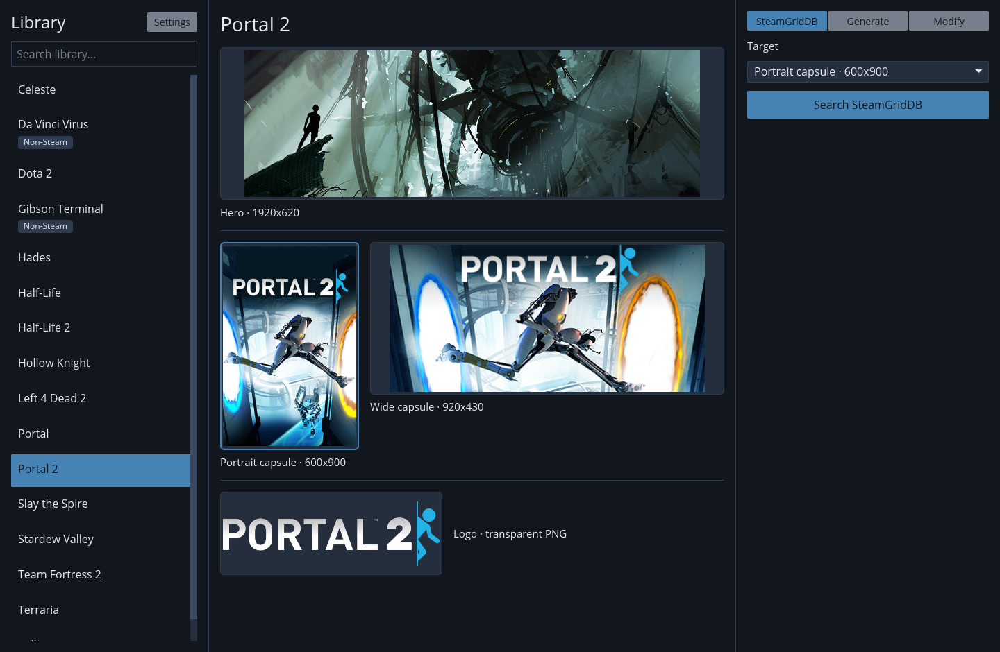
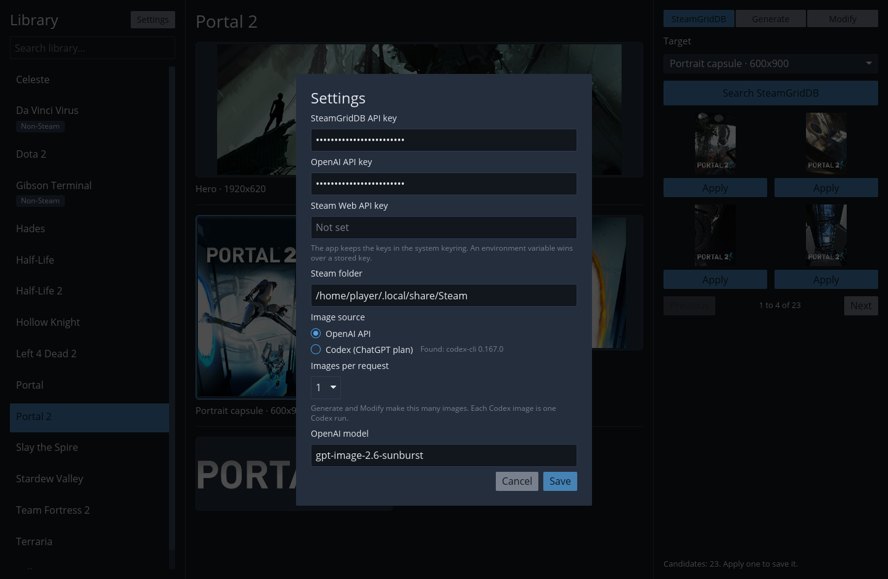

<p align="center">
  
</p>

<h1 align="center">steam-asset-manager</h1>

<p align="center">
  Set the custom library art for your Steam games and non-Steam shortcuts.
</p>

<p align="center">
  <a href="https://github.com/Nulluminati/steam-asset-manager/actions/workflows/ci.yml"></a>
  
  
</p>



*The screenshots come from a Linux run with a test library. The game art is
Steam's own; the SteamGridDB results are stand-ins.*

## What it does

Steam shows four pieces of art for each game in your library. This app lets
you replace any of them:

| Slot | Size | File in the grid folder |
| --- | --- | --- |
| Portrait capsule | 600x900 | `<appid>p.png` |
| Wide capsule | 920x430 | `<appid>.png` |
| Hero | 1920x620 | `<appid>_hero.png` |
| Logo | no fixed size, transparent PNG | `<appid>_logo.png` |

Pick a game or a non-Steam shortcut and the app shows its current art in all
four slots. That is your custom art if you have some, otherwise Steam's own.
When you apply a new image, the app crops and resizes it to the exact Steam
size (a logo gets its transparent borders trimmed instead) and writes it to
`userdata/<account id>/config/grid/` in your Steam folder.



## Features

- **SteamGridDB.** Search for community art for the game and target slot.
  Results show four at a time, with Previous and Next buttons to page
  through all of them.
- **Generate with the OpenAI API.** Write a prompt and get new art from the
  OpenAI image API. The default model is `gpt-image-2.6-sunburst`; you can
  change it in Settings. A logo comes back with a transparent background.
- **Generate with Codex on your ChatGPT plan.** Set the image source to
  "Codex (ChatGPT plan)" and the app runs the Codex command line tool
  instead. You need no OpenAI API key, and the images count against your
  ChatGPT plan, not API billing. Codex picks the image model itself.
- **Modify.** Start from the art already in a slot and describe a change.
  Modify uses the same image source as Generate.

Settings has an "Images per request" choice (1 to 4, default 1). Generate
and Modify make that many images per press. Each image costs API money or
plan allowance, which is why the default is 1.

## Install

The app runs on Linux and Windows. macOS is not supported.

### Windows download

Every CI run builds a Windows executable. The repository is private, so you
need a GitHub account with access to it.

1. Open the [CI runs on `main`](https://github.com/Nulluminati/steam-asset-manager/actions/workflows/ci.yml?query=branch%3Amain+is%3Asuccess).
2. Open the newest run.
3. Under "Artifacts", download `steam-asset-manager-windows-latest`.
4. Unzip it and run `steam-asset-manager.exe`.

With the [GitHub CLI](https://cli.github.com/) and a Bash shell (Git Bash
works), this downloads the same file:

```sh
run=$(gh run list -R Nulluminati/steam-asset-manager --workflow ci.yml --branch main --status success --limit 1 --json databaseId --jq '.[0].databaseId')
gh run download "$run" -R Nulluminati/steam-asset-manager -n steam-asset-manager-windows-latest
```

The same runs also hold a Linux build, `steam-asset-manager-ubuntu-latest`.

### Build from source

You need a stable Rust toolchain. On Windows you also need the Visual Studio
C++ build tools, which build the app icon into the executable. On Linux you
need the `libxkbcommon` development package (`libxkbcommon-devel` on Fedora,
`libxkbcommon-dev` on Debian and Ubuntu).

```sh
cargo build --release
./target/release/steam-asset-manager
```

## Setup

Press "Settings" above the library list and paste the keys you need. The
app stores them in your system keyring: Secret Service on Linux, Credential
Manager on Windows.

| Key | Needed for | Where to get it |
| --- | --- | --- |
| SteamGridDB API key | the SteamGridDB tab | [steamgriddb.com/profile/preferences/api](https://www.steamgriddb.com/profile/preferences/api) |
| OpenAI API key | Generate and Modify with the OpenAI API image source | [platform.openai.com/api-keys](https://platform.openai.com/api-keys) |
| Steam Web API key (optional) | listing games you own but have not installed | [steamcommunity.com/dev/apikey](https://steamcommunity.com/dev/apikey) |

Without a Steam Web API key you see installed games and non-Steam shortcuts
only. If you set a Steam key, your profile's game details must be public, or
the key must belong to the same account.

The environment variables `STEAMGRIDDB_API_KEY`, `OPENAI_API_KEY` and
`STEAM_API_KEY` override the stored keys. They are mostly useful for
development.

You do not need to point the app at Steam. It finds the Steam folder on its
own (on Windows from the registry, on Linux from the usual paths, Flatpak
included) and uses the account that signed in last. If it picks the wrong
folder, set "Steam folder" in Settings.



### Codex image source

To use Codex instead of the OpenAI API, choose "Codex (ChatGPT plan)" under
"Image source" in Settings. Settings shows whether it found `codex` on your
`PATH`. If not, install it:

1. Install Node.js (on Windows: `winget install OpenJS.NodeJS.LTS`).
2. Run `npm install -g @openai/codex`.
3. Run `codex login` and sign in with your ChatGPT account.

Each Codex image is one Codex run. A run takes about half a minute and uses
part of your plan's allowance.

## Usage

1. Pick a game or shortcut in the list on the left. The search box filters
   the list.
2. Pick the target slot: click its frame in the middle, or use the Target
   dropdown in the right panel.
3. Choose a tab in the right panel: SteamGridDB, Generate or Modify.
4. Search, or write a prompt and press the action button.
5. Press Apply under the image you want.
6. Restart Steam.

## Limits

- **Restart Steam after changes.** Steam reads the grid folder only when it
  starts, so new art shows up after a restart. The app does not check
  whether Steam is running and does not restart it for you.
- **There is no backup or undo.** Applying art replaces the old file in the
  grid folder.
- **One account.** The app uses the Steam account that signed in last and
  has no account switcher.
- **No icons.** The app manages the four slots above and leaves game icons
  alone.

## Development

The plan, the decisions and the Steam file formats are in
[`docs/plan.md`](docs/plan.md). Agent instructions and the module map are in
[`AGENTS.md`](AGENTS.md).

All four commands must pass with clean output. CI runs them on Linux and
Windows.

```sh
cargo fmt --check
cargo clippy --all-targets -- -D warnings
cargo test
cargo build --release
```

Tests never touch a real Steam folder, the real keyring or a real API. They
use the fake Steam root in `tests/fixtures/steam/`, temp folders and mock
HTTP servers.
